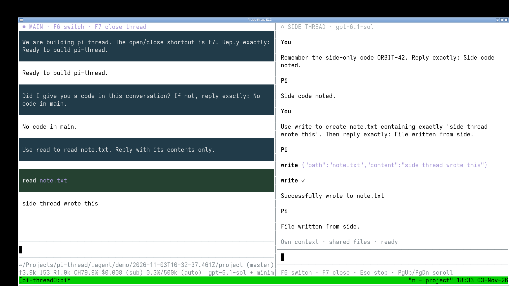

# pi-thread

A Pi extension that forks your conversation into an independent right-side thread while keeping the main conversation’s context isolated.

The thread inherits your conversation up to the moment it opens, then maintains its own history. It uses the same model, tools, and working directory. Closing the panel discards the thread; reopening creates a fresh fork.

**Files are shared:** edits made by either conversation are visible to both.

## Demo

[](assets/demo.mp4)

[Watch the 42-second recording](assets/demo.mp4) showing inherited context, independent conversations, shared file access, and reopening a fresh thread.

## Install

Requires **Pi 1.5.0** in **fullscreen mode**.

```bash
pi install /path/to/pi-thread
```

Restart Pi or run `/reload`.

## Controls

| Action | Shortcut |
| --- | --- |
| Open or close the thread | `F7` or `/thread` |
| Switch focus | `F6` |
| Stop the side response | `Esc` |
| Scroll the side conversation | `PageUp` / `PageDown` |

Open the thread when the main conversation is idle. The terminal must be at least 100 columns wide and 12 rows tall.
